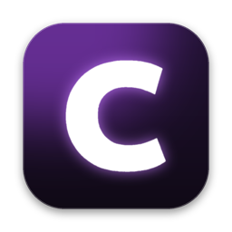
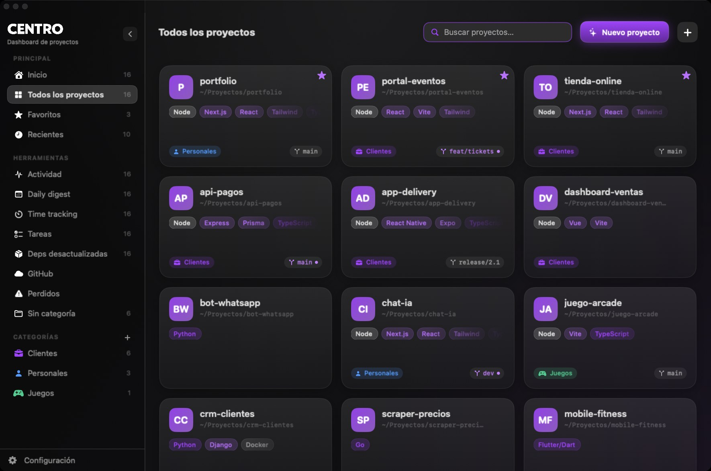

  

<h1 align="center">CENTRO</h1>

  <b>Todos tus proyectos de código en una app nativa para Mac.</b> 
  Encontrá cualquier proyecto en segundos y abrilo en Claude Code, tu editor, la terminal o Finder.

  <a href="README.md">Read in English</a>

  

  

---

Si tenés decenas (o cientos) de proyectos personales, de clientes y pruebas desparramados en carpetas, CENTRO los junta en un solo tablero: con buscador, categorías, estado de git y tecnologías a la vista, y a un clic de la herramienta con la que trabajás.

Nació para trabajar todos los días con **Claude Code**: elegís un proyecto y se abre una terminal en su carpeta con `claude` ya corriendo.

## Qué hace

**Encontrar y abrir proyectos rápido**
- **Lupa en la barra de menú**: tocás la lupa, escribís el nombre y abrís el proyecto con un clic en el logo de la herramienta. Enter usa tu primera opción. Funciona aunque la ventana esté cerrada.
- **Paleta de comandos** (`⌘K`) para saltar a cualquier proyecto, sección o acción.
- **Botones configurables**: Claude Code, Terminal o iTerm2, Finder, Cursor, VS Code, Antigravity, la app de Claude o tus propios comandos. Elegís qué botones aparecen en cada tarjeta y en la lupa.
- **Tu comando de Claude Code**: por defecto `claude --dangerously-skip-permissions`. Podés cambiarlo por `claude`, `claude --continue` o lo que quieras.

**Organizar**
- Agregás una carpeta que contiene tus proyectos (las subcarpetas nuevas aparecen solas) o proyectos de a uno.
- Categorías y subcategorías, favoritos, fijar arriba, nombres propios, notas, ocultar o quitar (nunca se tocan los archivos del disco).
- Arrastrá archivos a CENTRO para copiarlos o moverlos a cualquier proyecto.

**Ver qué está pasando**
- Tecnologías detectadas, rama de git y cambios sin commitear, avisos (falta `node_modules`, falta `.env`).
- **Inicio**: servidores corriendo y sus puertos, proyectos con cambios, recientes.
- **Actividad** (mapa de commits), **Daily digest** de los commits de hoy, **Deps desactualizadas** (`npm outdated`).
- Página de proyecto con archivos, README, panel de git (commit, pull, push, ramas) y acciones de los scripts de `package.json`.
- Servidor de desarrollo integrado con logs en vivo.

**Productividad**
- Registro de tiempo por proyecto con cronómetro en la barra de menú.
- Tareas e inbox para anotar rápido.
- GitHub: listar y clonar tus repos o publicar una carpeta como repo nuevo (usa el CLI oficial `gh`).

**Nativa y privada**
- SwiftUI, rápida aunque tengas cientos de proyectos.
- Español e inglés, se elige al abrirla por primera vez.
- Sin cuenta, sin telemetría. Todo queda en `~/Library/Application Support/CENTRO/`, con respaldo automático en cada arranque.

## Instalar

1. Descargá `CENTRO-x.y.z.dmg` de la [última versión](https://github.com/soykeviin/CENTRO/releases/latest).
2. Abrilo y arrastrá **CENTRO** a **Aplicaciones**.
3. La primera vez macOS la bloquea porque todavía no está notarizada por Apple:
   - Andá a **Ajustes del Sistema > Privacidad y seguridad**, bajá y tocá **Abrir igualmente** al lado de CENTRO.
   - O corré una vez en la terminal: `xattr -dr com.apple.quarantine /Applications/CENTRO.app`
4. Al abrirla elegís el idioma y cómo querés abrir tus proyectos. Todo se cambia después en **Configuración**.

**Requisitos:** macOS 15 Sequoia o superior (en macOS 26 se ve con Liquid Glass). Opcional: Claude Code, GitHub CLI (`brew install gh`), Node/npm.

## Compilar desde el código

Con Xcode 26 o superior: `open CENTRO.xcodeproj` y Run. Para armar el `.dmg` y `.zip` de una versión: `./scripts/build-release.sh`.

## Licencia

[MIT](LICENSE) © Kevin Caballero
